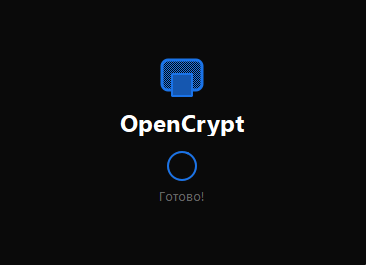

# OpenCrypt

A lightweight Windows file encryption utility powered by AES-256-GCM, Argon2id, and a native Rust core.

### Quick Start
Right-click any file in Windows Explorer -> Encrypt with OpenCrypt.

### CLI Usage

```cmd
opc "report.docx"
opc -d "report.docx.ocrypt"
```

### FAQ

#### How strong is the encryption?
OpenCrypt utilizes industry-standard AES-256-GCM authenticated encryption with keys derived via Argon2id.

<p align="center">
  
</p>
